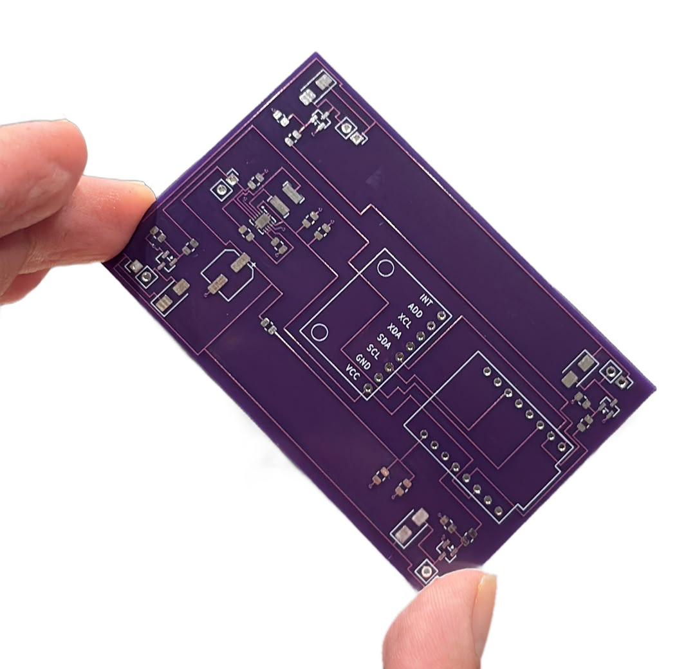

# ESP32-C3 Micro Quadcopter

A brushed-motor micro quadcopter built around a custom flight-controller PCB: ESP32-C3 SuperMini, MPU-6050 IMU, a buck-boost regulator that keeps the MCU alive when the battery sags, and four low-side MOSFET motor drivers.

**Status: in progress.** Rev A boards are fabricated. Next: assembly, bring-up and flight firmware.



*Rev A, as it came back from the fab.*

## Hardware overview

```
1S LiPo ──┬── TPS63001 buck-boost ── 3.3 V ──┬── ESP32-C3 SuperMini (flight control, planned ESP-NOW link)
          │                                  └── MPU-6050 IMU (I2C)
          ├── 47k / 47k divider ── ADC (battery voltage)
          └── motor + ──[8520 motor]── AO3400A ── GND      (x4, PWM from ESP32-C3)
```

| Item | Choice | Why |
|---|---|---|
| MCU | ESP32-C3 SuperMini module | Small, cheap, built-in radio for a planned ESP-NOW controller link |
| IMU | MPU-6050 (GY-521 module), I2C | 3-axis gyro + accelerometer for attitude estimation |
| Regulator | TI TPS63001 buck-boost, 1S LiPo → 3.3 V | Holds 3.3 V when motor current pulls the battery below 3.3 V, so the MCU does not brown out mid-flight |
| Inductor | 2.2 µH, Bourns SRN4018-2R2M | Value from the TPS63001 reference design |
| Motor drivers | 4× AO3400A N-MOSFET, low side | Logic-level gate, driven directly by ESP32-C3 PWM |
| Gate network | 100 Ω series + 10 kΩ pull-down per MOSFET | Limits gate current; keeps the motors off while the MCU boots |
| Flyback diodes | 4× SS34 Schottky | Clamp the motor's inductive kick when the MOSFET turns off |
| Battery sense | 47 kΩ / 47 kΩ divider + 100 nF | Halves the cell voltage into the ADC range |
| Bulk capacitor | 220 µF / 6.3 V low-ESR | Buffers motor current transients on the battery rail |
| Motors | 4× 8520 coreless brushed, 3.7 V | |
| Battery | 1S LiPo | |

The TPS63001 section follows the TI reference design: the fixed 3.3 V version with FB tied to VOUT, a 100 Ω / 100 nF filter on VINA, EN and PS/SYNC tied to VINA, 10 µF at the input and 2× 10 µF at the output.

### ESP32-C3 pin map

| GPIO | Function |
|---|---|
| GPIO3 | Motor 1 PWM (Q1 gate via R1) |
| GPIO4 | Motor 2 PWM (Q2 gate via R3) |
| GPIO6 | Motor 3 PWM (Q3 gate via R5) |
| GPIO7 | Motor 4 PWM (Q4 gate via R7) |
| GPIO5 | MPU-6050 SDA |
| GPIO10 | MPU-6050 SCL |
| GPIO0 | Battery voltage (ADC, 47k / 47k divider) |

The MPU-6050 AD0 pin is tied to GND, so the IMU sits at I2C address 0x68. Its INT pin is not connected.

## PCB

| Item | Value |
|---|---|
| Size | 53 × 84 mm |
| Layers | 2 |
| Thickness | 0.8 mm as ordered (the board file still lists 1.6 mm) |
| Placement | All 34 components on the top side; all routing on the top layer |
| Ground | Ground pour on the bottom layer; SMD ground pads tied to it with 16 vias |
| Tool | KiCad |

KiCad 10 schematic and board files are in `hardware/`.

## Rev A notes

Found during design review after the boards were ordered. Each item has a fix that does not need a new board.

1. **ESP32-C3 GND pin is not connected.** The schematic symbol numbers its power pins `-1`, `-2`, `-3`, while the footprint pads are named `5V`, `G`, `3.3`. The pad names did not match, so the `G` pad got no net.
   *Rev A fix:* bridge the `G` pad to the ground pour on the bottom side with solder, or run a short wire to GND.
   *Rev B:* match the symbol pin numbers to the footprint and run ERC before ordering.
2. **Motor power runs on 0.2 mm tracks.** Every track on the board is 0.2 mm, including the battery-to-motor path. That is fine for signals, but four 8520 motors draw several amps, and the tracks to the far motors are 75–95 mm long.
   *Rev A fix:* wire from the battery `+` pad to each motor `+` pad.
   *Rev B:* route with the track tool and net classes instead of graphic lines on copper, with at least 1.5–2 mm for the battery rail and 1 mm for the motor and drain tracks.
3. **Battery and motors on 2.54 mm headers.** Header pins are rated for a few amps; the motors together can pull 8–10 A at full throttle.
   *Rev A fix:* solder the battery and motor leads directly to the pads.
   *Rev B:* use a high-current battery connector (BT2.0 / XT30).

## Bring-up plan

1. Before power: check continuity from `G` to battery `−`, and check for no short between battery `+` and `−`.
2. First power from a current-limited supply (3.7 V, 0.5 A limit) instead of the battery.
3. Confirm 3.3 V on the ESP32-C3 `3.3` pin, then flash.
4. Read the MPU-6050 over I2C.
5. Spin each motor on its own, propellers off.
6. Flight firmware: attitude estimation from the MPU-6050 and a PID loop driving the four motors, with an ESP-NOW link to a controller.

## Repository layout

```
hardware/   KiCad 10 schematic (drone.kicad_sch) and PCB (drone.kicad_pcb)
docs/       photos
```
